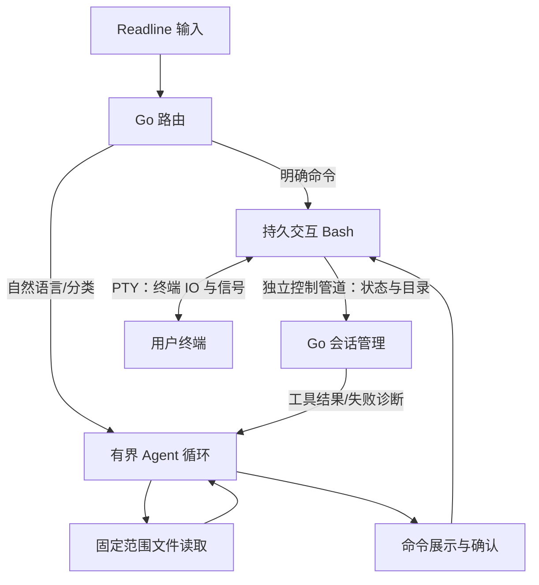

# LingCell

Linux 上的 Go 原生 AI Agent Shell。普通命令交给真实、持久的 Bash；自然语言进入有界 Agent 循环；Agent 提出的每条命令都需用户确认。

## 构建与运行

需要 Go 1.26 或更新版本、Bash、`stty`，以及交互终端。自动文件读取使用 Linux `openat2`，需要 Linux 5.6 或更新内核。依赖版本固定在 `go.mod` / `go.sum`。

```bash
make build
./bin/lingcell
```

没有模型配置时仍可使用普通命令与 `:sh`。启动后会加载 `~/.bashrc`，沿用别名、函数及已有 `PROMPT_COMMAND`，使用 LingCell 的输入编辑和提示符。

```text
ls -la
cd src
export APP_MODE=dev
:ai 帮我解释这个项目的入口，并提出修改建议
:sh printf '%s\n' "$APP_MODE"
:fix
:exit
```

| 指令 | 行为 |
| --- | --- |
| `:ai <需求>` | 强制进入 Agent |
| `:sh <命令>` | 跳过分类，交给 Bash |
| `:fix` | 诊断上一条普通命令 |
| `:help` | 显示帮助 |
| `:exit` / Ctrl-D | 退出并恢复终端 |

已知命令、别名、函数及明确 shell 结构优先直接执行。中文需求和明确的自然语言请求进入 Agent。其他输入调用模型分类；分类为 shell 的输入会先确认，执行原始输入。已知 shell 输入未完成引号或结构时，Enter 进入续行。基础 Tab 补全支持 Bash 内部命令、别名、函数、当前 PATH 可见的常见系统命令及路径；不加载个人 Bash 补全插件。

`find large files` 的首词是已知命令，因此会直接交给 `find`；表达自然语言需求时可用 `:ai find large files`。普通命令的执行权限来自用户输入，Agent 的执行权限来自确认界面。

## 模型配置

配置默认位于 `$XDG_CONFIG_HOME/lingcell/config.json`，未设置 XDG 时为 `~/.config/lingcell/config.json`。可用 `--config <路径>` 指定其他文件。参考 [config.example.json](config.example.json)：

```json
{
  "base_url": "https://your-provider.example/v1",
  "model": "your-tool-calling-model",
  "api_key_env": "LINGCELL_API_KEY",
  "max_decisions": 8,
  "timeout_seconds": 60
}
```

`base_url` 是兼容 Chat Completions 服务的 API 根路径，程序追加 `/chat/completions`。模型必须支持工具调用；没有硬编码供应商或模型。API 密钥仅从 `api_key_env` 指定的环境变量读取，应在启动 LingCell 前设置。无认证的本地服务可不设置该变量。密钥不写入配置、历史或日志。仓库不包含真实密钥，本次实现也未配置或调用真实供应商。

配置可增加 `history_file` 指定输入历史文件；设为 `""` 或使用 `--no-history` 可关闭持久历史。默认保存到 `$XDG_CACHE_HOME/lingcell/history`（通常是 `~/.cache/lingcell/history`），权限为 `0600`。只保存用户顶层输入，不保存确认回答、模型上下文、读取的文件或命令输出；本会话的 Bash 历史写入关闭。

## Agent 与文件边界

Agent 仅有 `list_files`、`read_file`、`run_command` 三个工具。文件工具自动执行；`run_command` 展示完整命令、实际工作目录及目的，输入 `y` 或 `yes` 后才执行。默认拒绝，拒绝后立即结束任务。每轮最多执行一条获批命令，然后将合并 PTY 输出、退出码、目录及截断标记作为工具结果返回模型。

自动读取范围固定为启动目录所属的最近 Git 项目根；无 Git 时固定为启动目录。`cd` 不扩大范围。文件工具仅接受项目相对路径，拒绝 `..`、范围外符号链接、被排除的符号链接目标和特殊文件，遵循各层 `.gitignore`。打开文件时使用内核范围约束并禁止路径在检查后被替换为符号链接。

默认排除 `.git`、依赖和构建目录、`.env*`、常见凭据目录、私钥文件及含私钥头的文本。每次读取最多 32 KiB，每个任务累计最多 256 KiB；目录列表最多 256 条，列表内容也计入预算。每条命令完整输出到终端，发送给模型的输出最多 64 KiB。读取内容和终端输出是工具数据，模型不能通过文本授予自己执行权限。

获批 Bash 命令使用当前用户的正常权限，包括读写项目外文件的权限；文件工具的范围约束针对自动读取。请在确认界面检查命令和目的。

普通命令失败会自动诊断；Ctrl-C 中断（130）、Ctrl-Z 停止（148），以及简单 `grep` / `diff` / `test` / `[` 的正常否定结果（1）不自动接管。管道、组合命令及重定向不使用否定结果豁免。Agent 命令失败继续当前任务，不嵌套另一层诊断。默认每个任务最多 8 次模型决策、单次请求 60 秒；网络错误、无效参数、循环上限或拒绝执行结束任务并返回提示符。

## 终端与架构



Go 在顶层编辑输入；命令通过独立管道按 NUL 边界提交，再由顶层 Bash `eval` 解析执行，从而保留目录、环境、别名、函数和作业状态，并支持超过 PTY 单行限制的输入。完成事件来自独立控制管道，不依赖匹配提示符。运行程序时切换为原始终端输入，转发 Ctrl-C / Ctrl-Z，支持 `jobs` / `fg` / `bg`，同步窗口尺寸；结束时归还输入并恢复终端模式。会话钩子被移除、控制通道断开或 Bash 退出会明确报错，命令不会自动重放。

| 目录 | 职责 |
| --- | --- |
| `cmd/lingcell` | CLI、配置入口、信号和退出恢复 |
| `internal/shell` | Bash、PTY、控制协议、状态与输出限制 |
| `internal/router` | 本地路由、续行及失败接管规则 |
| `internal/model` | 标准库 HTTP 客户端、分类与工具调用协议 |
| `internal/agent` | 决策上限、工具校验、逐条确认及结果反馈 |
| `internal/project` | 固定项目范围、排除规则、忽略规则和读取预算 |
| `internal/app` | Readline、基本补全、指令及交互流程 |
| `internal/config` | JSON 配置、默认值及校验 |

## 验证

```bash
make check
make build
python3 scripts/verify_terminal.py --binary bin/lingcell
```

Go 测试使用模拟模型与本地 HTTP 服务，覆盖 Bash 状态、个人钩子、长命令、多行及 heredoc、输出截断、取消和作业控制、路由、文件越界及 `.gitignore`、读取预算、工具反馈、拒绝、参数错误、超时与循环上限。`make check` 运行 `go vet` 和竞态测试。

PTY 验收脚本需要 Python 3 标准库，启动临时 HOME 和本地模拟模型，通过真实 CLI 验证输入编辑、续行、Ctrl-C/Z、`bg/fg`、缩放、Agent 确认/拒绝、错误诊断、分类、模型取消、历史与退出终端恢复。系统安装了 `vim` / `top` 时还会实际启动它们。脚本不使用真实供应商或远程 SSH 主机；成功的远程 SSH 会话及真实供应商工具调用需选定服务后联调。

MVP 仅支持 Linux 交互 CLI，不包含 GUI、多 Agent、MCP、后台自主任务或跨会话记忆。个人 Bash 编辑插件、极端提示符钩子以及主动修改 LingCell 内部钩子的配置不在兼容承诺内。

实现依据：[Bash 交互行为](https://www.gnu.org/software/bash/manual/html_node/Interactive-Shell-Behavior.html)、[creack/pty](https://github.com/creack/pty)、[reeflective/readline](https://github.com/reeflective/readline)、[mvdan shell 语法解析](https://pkg.go.dev/mvdan.cc/sh/v3/syntax)、[x/term](https://pkg.go.dev/golang.org/x/term)、[兼容工具调用协议示例](https://api-docs.deepseek.com/guides/tool_calls/)。
