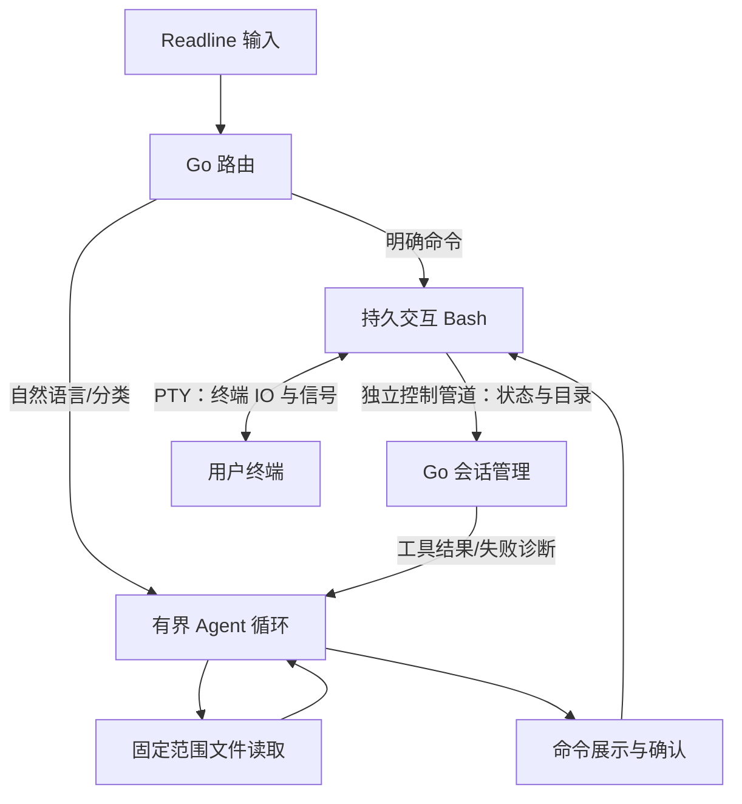

# LingCell

Linux 上的 Go 原生 AI Agent Shell。普通命令交给真实、持久的 Bash；自然语言进入有界 Agent 循环；Agent 提出的每条命令都需用户确认。

## 构建与运行

需要 Go 1.26 或更新版本、Bash、`stty`，以及交互终端。自动文件读取使用 Linux `openat2`，需要 Linux 5.6 或更新内核。依赖版本固定在 `go.mod` / `go.sum`。

```bash
make build
./bin/lingcell
```

没有模型配置时仍可使用普通命令与 `:sh`。启动后会加载 `~/.bashrc`，沿用别名、函数及已有 `PROMPT_COMMAND`，使用 LingCell 的输入编辑和提示符。

```text
ls -la
cd src
export APP_MODE=dev
:ai 帮我解释这个项目的入口，并提出修改建议
:sh printf '%s\n' "$APP_MODE"
:fix
:exit
```

| 指令 | 行为 |
| --- | --- |
| `:ai <需求>` | 强制进入 Agent |
| `:sh <命令>` | 跳过分类，交给 Bash |
| `:fix` | 诊断上一条普通命令 |
| `:session list/new/resume/show/delete` | 管理有界会话记录；删除需确认 |
| `:context` | 查看请求字节预算、摘要范围和轮次 |
| `:memory list/show/add/update/forget` | 查看和修正长期记忆 |
| `:help` | 显示帮助 |
| `:exit` / Ctrl-D | 退出并恢复终端 |

已知命令、别名和函数优先直接执行。未知首词且以明确自然语言请求前缀开头的输入（如“帮我解释 `$PATH`”）进入 Agent，第一词中的路径或赋值示例（如“帮我解释PATH=/bin”）、分号、换行或未闭合引号也不会因此直接执行。以请求前缀开头的未知路径若要作为命令执行，可用 `:sh`。其余明确 shell 结构（脚本路径、赋值、重定向、管道、复合结构）直接执行；其他中文需求进入 Agent。无法明确归类的混合输入（如 `inspect $PATH`）调用模型分类；分类为 shell 的输入会先确认，执行原始输入。已知 shell 输入未完成引号或结构时，Enter 进入续行。基础 Tab 补全支持 Bash 内部命令、别名、函数、当前 PATH 可见的常见系统命令及路径；不加载个人 Bash 补全插件。

`find large files` 的首词是已知命令，因此会直接交给 `find`；表达自然语言需求时可用 `:ai find large files`。普通命令的执行权限来自用户输入，Agent 的执行权限来自确认界面。

## 离线诊断与交互提示

`./bin/lingcell --doctor [--config <路径>]` 无需交互终端，检查 Bash/stty、配置合法性、模型 endpoint 与名称、凭据环境变量是否有值，以及项目读取的内核路径约束。默认不联网、不写配置或历史，不显示配置值、密钥、文件名或内容。任一 `FAIL` 返回退出码 1；`WARN` 表示凭据变量缺失（无认证本地服务仍可使用），`SKIP` 表示未指定凭据变量。缺少模型配置不影响普通 shell。

交互时以静态文本提示输入分类、等待模型的当前决策轮次、读取文件、等待确认和执行命令；等待模型可用 Ctrl-C 取消。模型失败区分配置、认证、限流、服务异常、超时、取消与协议不兼容，并提供下一步提示。失败后返回提示符，普通命令仍可运行；非流式请求、逐条确认、无自动重试行为保持不变。确认详情或阶段提示写入失败时停止任务，不进入执行。

## 模型配置

配置默认位于 `$XDG_CONFIG_HOME/lingcell/config.json`，未设置 XDG 时为 `~/.config/lingcell/config.json`。可用 `--config <路径>` 指定其他文件。参考 [config.example.json](config.example.json)：

```json
{
  "base_url": "https://your-provider.example/v1",
  "model": "your-tool-calling-model",
  "api_key_env": "LINGCELL_API_KEY",
  "max_decisions": 8,
  "timeout_seconds": 60,
  "context_max_bytes": 131072
}
```

`base_url` 是兼容 Chat Completions 服务的 API 根路径，程序追加 `/chat/completions`。模型必须支持工具调用；没有硬编码供应商或模型。API 密钥仅从 `api_key_env` 指定的环境变量读取，应在启动 LingCell 前设置。无认证的本地服务可不设置该变量。密钥不写入配置、历史或日志。仓库不包含真实密钥，本次实现也未配置或调用真实供应商。

配置可增加 `history_file` 指定输入历史文件；设为 `""` 或使用 `--no-history` 可关闭持久历史。默认保存到 `$XDG_CACHE_HOME/lingcell/history`（通常是 `~/.cache/lingcell/history`），权限为 `0600`。输入历史只保存顶层输入；会话记录另外保存有界请求、模型响应和工具结果，`--no-history` 不关闭会话记录。使用 `--ephemeral` 关闭全部本次持久化和长期记忆读取。本会话的 Bash 历史写入关闭。

## 连续会话与长期记忆

正常启动新会话；退出后用 `./bin/lingcell --resume <id>` 显式恢复，必须从匹配的固定项目根启动。会话存于 `$XDG_STATE_HOME/lingcell/runtime.db`（默认 `~/.local/state/lingcell/runtime.db`），有进程独占锁。恢复不续跑命令；Bash 是新进程，变量、作业与机器状态需重新获取。进程内切换会话不改变当前 Bash。

上下文默认按实际模型请求 JSON 限制为 128 KiB，超限摘要较旧轮次并保留原始记录；摘要失败或仍超限会停止请求。任务结束后自动提取小型有来源长期记忆，新会话通过工具按需检索。记忆可能错误，可查看、修改和删除；历史确认和记忆不授予执行权限。

记录每轮最多 2 MiB、每会话最多 64 MiB；已知凭据及可识别敏感模式过滤不保证识别任意秘密。写入故障停止 Agent，普通 shell 保留可用；中断命令结果未知时明确提示，绝不重试。详见 [runtime 行为、管理指令与边界](docs/runtime.md)。

## Agent 与文件边界

每次任务开始提供程序生成的 Linux 内核、CPU 架构、有效权限级别（root/non_root）、当前 Bash 目录、固定项目读取根和工具名称。该上下文不含环境变量、账户身份详情、进程列表或配置内容；实时机器状态通过获批命令查询。

Agent 提供 `list_files`、`read_file`、`search_text`、`read_file_range`、`run_command`，以及 `read_session_history` 和 `search_memory` 数据工具。文件工具自动执行；`run_command` 展示完整命令、实际工作目录及目的，输入 `y` 或 `yes` 后才执行。默认拒绝，拒绝后立即结束任务。每轮最多执行一条获批命令，然后将合并 PTY 输出、退出码、目录及截断标记作为工具结果返回模型。

自动读取范围固定为启动目录所属的最近 Git 项目根；无 Git 时固定为启动目录。`cd` 不扩大范围。文件工具仅接受项目相对路径，拒绝 `..`、范围外符号链接、被排除的符号链接目标和特殊文件，遵循各层 `.gitignore`。打开文件时使用内核范围约束并禁止路径在检查后被替换为符号链接。

默认排除 `.git`、依赖和构建目录、`.env*`、常见凭据目录、私钥文件及含私钥头的文本。每次读取最多 32 KiB，每个任务累计最多 256 KiB；目录列表最多 256 条，列表内容也计入预算。每条命令完整输出到终端，发送给模型的输出最多 64 KiB。读取内容和终端输出是工具数据，模型不能通过文本授予自己执行权限。

优先用 `search_text`（`path` 为项目相对目录、`query` 为非空字面查询）定位，再用 `read_file_range`（项目相对 `path`、`start_line` 默认 1、`line_count` 默认 100 / 最大 200）查看片段。搜索递归、大小写敏感、不支持正则，按路径/行号返回最多 100 个匹配行；同一行只返回一次。不跟随目录符号链接，允许通过现有边界检查的文件链接。分段读取返回实际起止行，超过 EOF 返回空内容与 0/0 行范围；非法行参数返回工具错误。旧 `list_files` / `read_file` 行为保持兼容。

新工具的完整 JSON 结果（含路径/行号/转义开销）计入共享 32 KiB 单次 / 256 KiB 每任务返回预算；旧工具继续按内容字节计费。搜索与分段读取另共享每任务 16 MiB 文件内容扫描预算，搜索每次最多扫描 8 MiB / 枚举 4096 个目录项，每文件最多 1 MiB，超大文件明确跳过；分段读取每次最多扫描 8 MiB。扫描包含拒绝返回的非文本/私钥内容，并检查取消；不创建索引或缓存。忽略规则检查复用原实现，不计入文件内容扫描预算。结果的 `truncated`、`limits`、扫描字节和跳过计数说明证据范围；达到预算时报告限制，有限结果不能当作完整项目结论。文本和私钥检查覆盖扫描到的前缀，未扫描后缀不作内容保证。

机器问题先通过确认命令获取实际状态，再决定处理；修改代码继续通过逐条获批的 `run_command`，随后提出查看实际差异与运行验证。最终解释须区分已执行、尚未执行、验证失败或缺失的事项。模拟服务验证程序工具闭环；真实模型的任务决策效果仍需授权配置后联调。

获批 Bash 命令使用当前用户的正常权限，包括读写项目外文件的权限；文件工具的范围约束针对自动读取。请在确认界面检查命令和目的。

普通命令失败会自动诊断；Ctrl-C 中断（130）、Ctrl-Z 停止（148），以及简单 `grep` / `diff` / `test` / `[` 的正常否定结果（1）不自动接管。管道、组合命令及重定向不使用否定结果豁免。Agent 命令失败继续当前任务，不嵌套另一层诊断。默认每个任务最多 8 次模型决策、单次请求 60 秒；网络错误、无效参数、循环上限或拒绝执行结束任务并返回提示符。

## 终端与架构



Go 在顶层编辑输入；命令通过独立管道按 NUL 边界提交，再由顶层 Bash `eval` 解析执行，从而保留目录、环境、别名、函数和作业状态，并支持超过 PTY 单行限制的输入。完成事件来自独立控制管道，不依赖匹配提示符。运行程序时切换为原始终端输入，转发 Ctrl-C / Ctrl-Z，支持 `jobs` / `fg` / `bg`，同步窗口尺寸；结束时归还输入并恢复终端模式。会话钩子被移除、控制通道断开或 Bash 退出会明确报错，命令不会自动重放。

| 目录 | 职责 |
| --- | --- |
| `cmd/lingcell` | CLI、配置入口、信号和退出恢复 |
| `internal/shell` | Bash、PTY、控制协议、状态与输出限制 |
| `internal/router` | 本地路由、续行及失败接管规则 |
| `internal/model` | 标准库 HTTP 客户端、分类与工具调用协议 |
| `internal/agent` | 单轮决策、工具校验、逐条确认及结果反馈 |
| `internal/runtime` | 会话记录、恢复、上下文预算/摘要及有来源长期记忆 |
| `internal/project` | 固定项目范围、排除规则、忽略规则和读取预算 |
| `internal/app` | Readline、基本补全、指令及交互流程 |
| `internal/config` | JSON 配置、默认值及校验 |

## 验证

```bash
make fmt
make check
make lint
make terminal
```

Go 测试使用模拟模型与本地 HTTP 服务，覆盖 Bash 状态、个人钩子、长命令、多行及 heredoc、输出截断、取消和作业控制、路由、文件越界及 `.gitignore`、读取预算、工具反馈、拒绝、参数错误、超时与循环上限。`make check` 检查 `gofmt`、`go mod tidy -diff`，再运行 `go vet` 和竞态测试。`make lint` 运行 Staticcheck，安装方法见维护指南；`make terminal` 会先构建 CLI，再执行 PTY 验收。

PTY 验收脚本需要 Python 3 标准库，启动临时 HOME 和本地模拟模型，通过真实 CLI 验证输入编辑、续行、Ctrl-C/Z、`bg/fg`、缩放、Agent 确认/拒绝、错误诊断、分类、模型取消、历史与退出终端恢复。系统安装了 `vim` / `top` 时还会实际启动它们。脚本不使用真实供应商或远程 SSH 主机；成功的远程 SSH 会话及真实供应商工具调用需选定服务后联调。验收会分别打印 `PASS` / `FAIL` / `SKIP`；默认运行三个独立 CLI 会话，缺少 vim/top/ssh 时明确跳过，只运行 `ssh -V` 不表示远程连接已验证。

`make terminal` 还运行 `scripts/verify_runtime.py`：多轮、重启恢复、会话独占/项目根校验、按需记忆、管理指令、未知结果不重放、存储失败与临时模式。

`make terminal` 同时运行 [固定通用任务场景](docs/task-scenarios.md)：项目入口定位、错误诊断、模拟机器状态/处理拒绝、获批代码修改/实际差异/验证、失败反馈、边界与取消。任务脚本打印实际决策和确认次数；它验证程序工具闭环，真实模型的通用任务效果仍未验证。

可选测试需要用户指定并授权目标或配置：

```bash
# 使用已授权目标、既有非交互认证与 known_hosts；不接受新主机指纹。
python3 scripts/verify_terminal.py --binary bin/lingcell --ssh-target user@host
# 加载已授权个人配置；bashrc 的本地钩子会实际执行。
python3 scripts/verify_terminal.py --binary bin/lingcell --bashrc "$HOME/.bashrc"
# 固定最低版本，防止 Go 自动切换到更新工具链。
GOTOOLCHAIN=local make check GO=/path/to/go1.26.0/bin/go
```

SSH 检查通过远端只读 sh 握手验证输入、窗口缩放、Ctrl-C 及退出后本地输入恢复；不写远端文件。个人 bashrc 会复制到临时 HOME，在三次会话中加载；依赖 `$HOME` 中其他文件的配置可能需要额外准备。这是隔离环境兼容测试，不代表原始 HOME 下所有插件已验证。个人配置与 SSH 模式失败时不输出原始终端片段，临时目录退出后清理。报告只记录结果；真实服务/远程环境或个人配置未运行时仍明确列为未验证。

## 开发与维护

- [AGENT.md](AGENT.md)：架构约束、代码职责、Go 开发约定、验证命令和 Git 工作流程。
- [AGENTS.md](AGENTS.md)：供维护工具自动发现的入口，指向同一份维护指南。
- [Go 规范检查记录](docs/go-review.md)：检查依据、已修正问题和验证范围。
- [开发日志](docs/development-log.md)：完成的开发工作、实际检查结果和后续事项。
- [开发工作流](docs/workflow.md)：独立开发/测试 Agent、分支与 worktree、交接和回滚操作。
- [参与开发](CONTRIBUTING.md)：维护规范入口和本地 hooks 启用方法。

开发在短期任务分支及独立 worktree 进行；每个有意义的变动都保存 Git 提交。正式验收必须派生干净上下文测试 subagent，在候选 SHA 的独立工作树验证；通过后才整合到稳定 `main`，保留任务合并记录。开始维护请先读 AGENT.md 并启用仓库 hooks。当前模块名 `lingcell` 用于本地开发；确定远程仓库并需要远程 `go install` 时，再调整为仓库模块路径。

目前仅支持 Linux 交互 CLI，不包含 GUI、多 Agent、MCP 或后台自主任务。个人 Bash 编辑插件、极端提示符钩子以及主动修改 LingCell 内部钩子的配置不在兼容承诺内。

实现依据：[Bash 交互行为](https://www.gnu.org/software/bash/manual/html_node/Interactive-Shell-Behavior.html)、[creack/pty](https://github.com/creack/pty)、[reeflective/readline](https://github.com/reeflective/readline)、[mvdan shell 语法解析](https://pkg.go.dev/mvdan.cc/sh/v3/syntax)、[x/term](https://pkg.go.dev/golang.org/x/term)、[兼容工具调用协议示例](https://api-docs.deepseek.com/guides/tool_calls/)。
